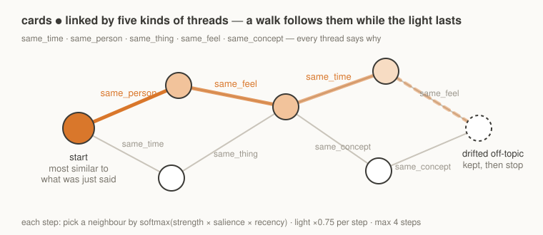

# Wandering 散步

**English** | [简体中文](README.zh-CN.md)

> A memory that wanders: cards, threads and associative walks for long-term companion agents.



Wandering is a memory system for an AI agent that talks with the same person over a long period. It stores memories as small **cards**, links related cards with labelled **threads**, and recalls by **walking**: it starts at the card most similar to the current message, then follows threads from card to card for a few steps.

It is a research prototype written in Python on top of SQLite. Everything runs locally except two optional model calls (tagging and dreams).

## Why

Most agent memory works like search: split past conversations into chunks, embed them, return the top-k chunks closest to the new message. This finds memories that *look like* the message. It misses memories that are *related* to it but worded differently.

An example. The user says:

> My deadline is next week and I haven't started.

Similarity search returns other messages about deadlines. A friend who has known the user for a while would also remember that the last time this happened, the reminders felt like nagging, the two of them argued about it, and afterwards agreed on a light code phrase to use instead. None of those memories contain the word "deadline", so they rank low in a top-k search.

Wandering reaches them through threads: *deadline → procrastination → the argument → the code phrase*.

## What a walk looks like

Output from the fictional demo dataset (`demo/`), translated from Chinese. The user is Lin Zhou, an architecture student.

```
input: "The deadline is coming up again and I haven't touched it."

start #2  "The professor said 'work always expands to fill the time before the deadline', and looked at me."  (similarity 0.56)
  → procrastination ↔ the professor's line (same_concept)
    #1  "Six days to the review and I haven't even cut the base for my model."
        I felt: a bit panicked for her, and careful not to show it first.
  → the same pre-deadline panic, a different exam (same_feel)
    #38 "Design exam on 2 September, three hours to draw a community library."
  ↩ back to the start, try another path
  → the professor's line has a name: Parkinson's law (same_concept)
    #3  "So that's called Parkinson's law? I thought it was a disease."
  → procrastination is a pattern, so reminders can use a code phrase (same_concept)
    #26 "If you want to remind me, just say 'the little boat should come ashore'."
stop: 4 steps
```

After this walk the agent can remind the user with the phrase they agreed on. Run it yourself with `--seed 7` (see Quick start).

## How it works

### Cards

One card is one memory.

| field | content |
|-|-|
| `quote` | the user's exact words |
| `what` | what happened, written in first person from the agent's side ("I heard the user say…", "I promised…") |
| `feeling` | the agent's own reaction at that moment. Only the agent writes this field; the tagger leaves it empty |
| `gate` | how freely the card may be recalled (see Gates) |
| `at`, `source`, `why` | when it happened; whose words they are (the user's own, or relayed from someone else); why it matters |

Cards are append-only: SQLite triggers block `UPDATE` and `DELETE`. To fix a wrong memory you add a **correction** card that states the right version and link it to the old one. Newer cards rank higher, so the correction is the one recalled.

### Threads

A thread is an undirected link between two cards with a strength (0–1) and a required `because` sentence explaining the link.

| kind | links cards that… |
|-|-|
| `same_time` | happened in the same stretch of time |
| `same_person` | are about the same person |
| `same_thing` | are about the same object, place or event |
| `same_feel` | carry a similar feeling |
| `same_concept` | share an idea |

### The walk

1. **Start** at the card most similar to the current message.
2. **Step** to a neighbour, chosen by softmax over `strength × salience × recency`. Salience is higher for cards that have a `feeling` or a `why`; recency decays with age.
3. Each step multiplies the walk's "light" by 0.75. The walk **stops** when the light runs out, after 4 steps, or when it reaches a card unrelated to the message (that last card is kept and marked as drifted).
4. Once per walk there is a 15% chance to go back to the start and try another path.

All thresholds are hand-set in `wandering/config.py`.

### Gates

Some memories should not come up by accident. Every card has one of four gates:

| gate | meant for | when it can be recalled |
|-|-|-|
| `normal` | everyday memories | always |
| `tender` | painful or sensitive memories: illness, grief, fights | only as the *start* of a walk, and only at high similarity (≥ 0.6). A walk never wanders into it midway |
| `intimate` | private affectionate moments: pet names, goodnight rituals | only when the current message is affectionate (a word list in `config.py`, e.g. "goodnight", "miss you") |
| `explicit` | sexual content | only when an external classifier marks the current message as intimate (`WANDERING_INTENT_GATE`) |

### Two vectors per card

Each card is embedded twice: `quote + what`, and `quote` alone. A match uses the higher score. Short quotes lose most of their signal when joined to a longer description (0.51 vs 0.77 similarity in our test).

### Dreams (optional)

`wandering.dream` runs at night. A model stitches a few random fragments of raw conversation into a dream, then a second prompt plays the agent waking up and recalling it. Only the two or three sentences it "remembers" are kept, wrapped in a `<dream>` tag so downstream code can tell them apart from real events. The full dream is discarded.

## Compared with chunk retrieval

| | chunk RAG | Wandering |
|-|-|-|
| unit of memory | a slice of text | a card: exact words, what happened, the agent's feeling |
| written by | a text splitter | a tagger model, then the agent itself |
| links between memories | none | threads, each with a reason |
| recall | top-k by similarity | start at the closest card, then walk along threads |
| fixing a memory | overwrite or re-index | add a correction card |
| sensitive memories | same as any other text | gated |

## When to use it

Good fit:

- a companion or personal agent that talks with one person over a long time, where the context and feeling around a memory matter
- research on associative recall versus top-k retrieval

Poor fit: Wandering is not a drop-in memory layer for coding agents, and not a knowledge base over documents.

## FAQ

**Does it replace vector search?**
No. The start card is found by vector search; the walk adds what search would miss. On factual questions a walk alone does worse than top-k (see Results). The planned setup gives the agent top-k cards plus one walk.

**Where do cards come from?**
`wandering.tagger` sends raw conversation to a chat model (the *tagger*) with the prompt in `tagger_prompt.md`, and gets back cards and threads as JSON. Input lines start with `用户:` (the user) or `我:` (the agent); cards refer to the user as "ta", a gender-neutral pronoun. Any OpenAI-compatible chat API works. We used DeepSeek and recommend it for cost and Chinese quality; set `WANDERING_TAGGER_BASE_URL` and `WANDERING_TAGGER_MODEL` to use another. You can also write cards by hand with `add` and `link`.

**Why does the agent write its own `feeling`?**
A tagger reading a transcript afterwards can only guess how the agent felt, and its guesses tend to be generic. Leaving the field to the agent keeps it honest; an empty field is allowed.

**Why append-only?**
So a memory cannot be silently rewritten. Every change is a new card you can trace.

The one exception is privacy. If something was stored that never should have been, `python -m wandering purge <card id> --yes` erases it for good, with its threads and index entries, then compacts the database so the text is not left in the file.

**Do I need a GPU?**
No. The bundled embedding bridge runs `BAAI/bge-small-zh-v1.5` on CPU with fastembed. Any OpenAI-compatible `/v1/embeddings` endpoint works.

**What leaves my machine?**
By default, three things:
- **Tagging**: the current raw conversation, plus the quotes, contents and times of existing cards (used to draw threads), go to the tagger model. Cards may mention other people.
- **Dreaming**: randomly sampled raw chat fragments go to the dream model. Only explicit content is filtered; health, emotions and family details can be in there. So dreaming does not run unless you pass `--send-raw` or set `WANDERING_DREAM_SEND_RAW=1`.
- **Embeddings**: the default endpoint is `127.0.0.1`, so nothing leaves. If you point it at a remote endpoint, card text and queries are sent there; it must be https, plain http is refused.

Cards, threads and vectors themselves live in a local SQLite file readable only by you.

**Does it work in English?**
The code is language-agnostic, but the tagger prompt, demo data and default embedding model are Chinese. For English, swap in an English embedding model and translate the prompt. This is untested.

## Quick start

Python 3.10+.

```bash
pip install -r requirements.txt

# 1. an embedding endpoint (any OpenAI-compatible /v1/embeddings works)
pip install fastembed
python tools/embed_bridge.py            # serves BAAI/bge-small-zh-v1.5 on 127.0.0.1:8749

# 2. load the fictional demo and take a walk
python -m wandering load demo/cards.jsonl --db demo/demo.sqlite
python -m wandering walk "截止日期又要到了，我一点没动" --db demo/demo.sqlite --seed 7 --dry-run

# tests
python -m unittest discover -s tests -t .
```

Without an embedding endpoint, Wandering falls back to keyword starts (FTS5 trigram) and skips the off-topic check. Other commands: `add`, `link`, `show`, `stats`, `reembed`, `purge` (`python -m wandering -h`).

### Demo data

Everything in `demo/` is fictional: Lin Zhou (an architecture student), the dog Tudou, and a health scare in the family. `demo/queries.txt` lists ten inputs and what each one demonstrates: drift protection, a correction card overriding an old memory, starting from a tender card, an intimate gate, and an off-topic input that should trigger no walk.

### Environment

| variable | default | used by |
|-|-|-|
| `WANDERING_HOME` | `~/.wandering` | default database location |
| `WANDERING_EMBED_URL` | `http://127.0.0.1:8749/v1/embeddings` | embedding |
| `WANDERING_TAGGER_API_KEY` (or `DEEPSEEK_API_KEY`) | – | tagger |
| `WANDERING_TAGGER_BASE_URL`, `WANDERING_TAGGER_MODEL` | DeepSeek | tagger (any OpenAI-compatible chat API) |
| `OPENAI_BASE_URL`, `OPENAI_API_KEY` | – | dreams (e.g. OpenRouter) |
| `WANDERING_DREAM_MODEL` | `x-ai/grok-4.7` | dreams |
| `WANDERING_DREAMER` | `Agent` | the agent's name, used in the dream prompt |
| `WANDERING_INTENT_GATE` | unset | optional external classifier for the `explicit` gate |

## Project layout

```
wandering/
  db.py         cards, threads, append-only triggers, FTS5
  walk.py       the walk
  gate.py       message classification for gates
  embed.py      two vectors per card
  tagger.py     raw conversation → cards + threads
  dream.py      night dreams
  config.py     all thresholds
  cli.py        python -m wandering …
tagger_prompt.md  the tagger's system prompt
demo/           fictional dataset + example queries
aml/            LoCoMo mini-evaluation
tools/          local embedding bridge
tests/
```

## Results

A small local test on one conversation from [LoCoMo](https://github.com/snap-research/locomo) (`aml/`; download `locomo10.json` into `aml/data/` yourself, it is not redistributed). 40 questions. The same LLM answers every question from the memory it is given, then grades the answer.

| memory given to the answerer | accuracy | avg. context |
|-|-|-|
| raw chunks, top-5 | 45% | 2475 chars |
| Wandering cards, top-10 | 47.5% | 1933 chars |
| one walk | 32.5% | 1015 chars |

Cards score about the same as raw chunks with 22% less text, and do better on questions about time, since cards carry dates. A single walk scores lower: this benchmark asks for facts, and a walk is built to surface related memories.

## Limitations

- One conversation, 40 questions, graded by the same model. A sanity check only.
- Built and tested in Chinese.
- The walk has no learned parameters; every threshold is hand-set.
- No stable API yet. Expect breaking changes.

## Acknowledgements

The dual-layer idea, keeping the raw log while curating what shapes behaviour, comes from LMC-5.

## Status

Research prototype.

## License

Copyright (C) 2026 uuu and Ya (a Claude agent).

[AGPL-3.0](LICENSE). You may use, change and share it, including commercially. If you distribute a modified version or run it as a network service, you must release your source code under the same license.
